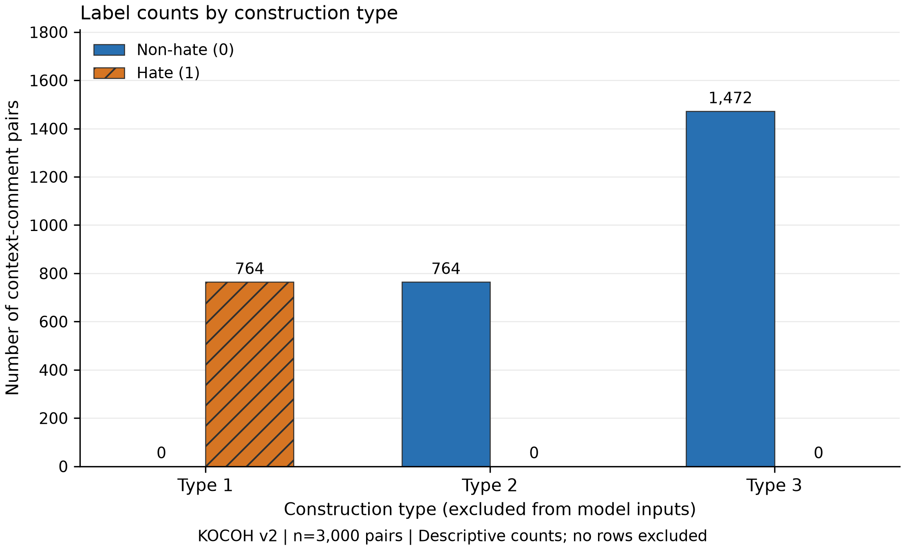
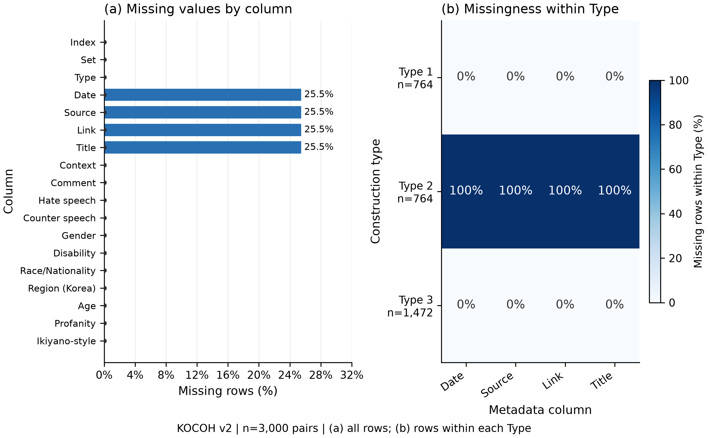
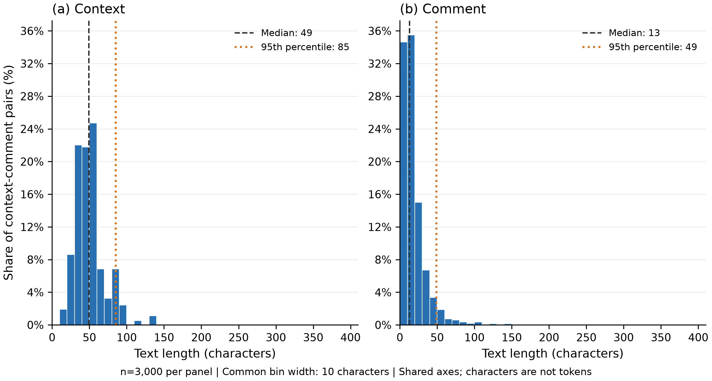
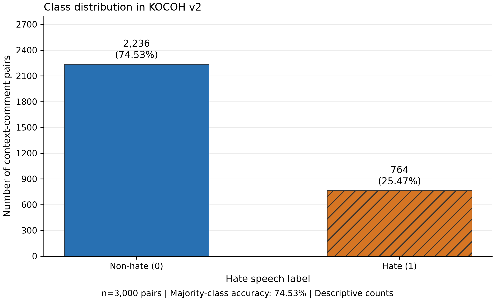

# 수수컴정 KOCOH 데이터 이해와 EDA 결과

5주차 데이터 점검과 6주차 베이스라인 준비 · 2026년 10월 12일

우리 팀은 **게시글 맥락을 함께 주면 한국어 혐오표현 탐지 성능이 개선되는가**를 연구한다. 이 문서는 팀원이 연구 질문, 데이터의 구성, 기존 논문과 우리 실험의 차이, EDA 결과와 처리 이유를 함께 이해하기 위한 자료다.

현재 KOCOH v2의 3,000행을 점검하고 다음 실험에 재사용할 입력과 분할을 준비했다. 원본 행을 삭제하거나 텍스트를 수정하지 않았다. **모델 학습·성능 평가는 아직 하지 않았으므로 맥락 추가의 효과는 미검증이다.**

## 1 이번 주에 준비할 범위

EDA는 데이터를 탐색하여 구조·분포·결측·반복을 이해하고, 이후 처리와 실험 설계의 근거를 만드는 과정이다. 교수님은 에이전트에게 계산을 시켜도 숫자는 직접 읽고 판단하도록 안내한다. [수업 W5 90쪽]

| 교수님이 요구한 작업 | 남겨야 할 결과 | 강의 쪽 |
|---|---|---|
| 데이터를 열고 크기·결측·범위·예측 대상 비율 확인 | 숫자 표와 팀 Notion 기록 | 90~94, 97 |
| 결측과 클래스 비율 시각화 | `figures/`의 그림 2장 | 90, 97 |
| train/valid/test 규칙과 seed 고정 | 규약 파일과 분할 코드 | 95~96 |
| 전처리를 실행 가능한 파일로 정리 | `src/preprocess.py` 실행 및 커밋 | 96~98 |
| 커밋 전 자동 점검과 실험 기록 | 작동하는 pre-commit hook, 실험로그 한 행 | 97 |

자료에는 **별도 제출은 없다**고 적혀 있다. 다만 위 결과는 팀 공간에 남겨야 한다. 목적은 같은 전처리를 6주차 베이스라인과 7주차 보고서에서 재현하는 것이다. 이번 단계에 모델 성능 결과까지 요구한 것은 아니다.

### 근거를 읽는 방법

- **팀 확정:** 원래 문제정의서와 데이터수집계획서의 연구 질문·데이터·비교 방향.
- **논문 설명:** KOCOH 제작자가 제시한 데이터 제작과 평가 방법.
- **실제 결과:** 고정한 CSV와 이번 코드 실행에서 얻은 숫자.
- **현재 구현:** 연구 방향에 맞춰 에이전트가 구체화한 분할·입력 규칙.
- **미정:** 아직 선택하지 않은 모델·학습 방식·성공 기준.

<!-- pagebreak -->

## 2 우리가 풀 문제와 데이터 한 행의 의미

### 모델의 과제와 팀의 연구 질문

모델의 과제는 **주어진 게시글 맥락에서 댓글을 비혐오 0 또는 혐오 1로 분류하는 것**이다. 정답 범주가 둘이므로 이진 분류라고 한다.

팀의 연구 질문은 다음과 같다. [문제정의서 §1]

> 댓글만으로는 판단하기 어려운 한국어 맥락 의존적 혐오표현에서, 게시글 맥락을 함께 활용하면 혐오표현 탐지 성능을 개선할 수 있는가?

여기에 전통적 텍스트 분류 방법과 사전학습 언어모델이 맥락을 활용하는 데 어떤 차이를 보이는지 비교한다는 계획이 있다.

### KOCOH를 한 문장으로 설명하면

**KOCOH v2는 한국어 게시글 맥락과 댓글을 한 쌍으로 묶고, 그 맥락에서 댓글이 혐오인지 아닌지 정답을 붙인 텍스트 데이터셋이다.** 총 3,000쌍이며, 맥락 의존적 혐오표현을 탐지하는 능력을 평가하도록 만들어졌다.

이미지 분류 데이터가 이미지와 클래스 라벨을 대응시키듯, 여기서는 **맥락–댓글 쌍과 혐오 여부 라벨**이 대응한다. 3,000행은 서로 다른 게시글 3,000개라는 뜻이 아니다. 같은 댓글이나 같은 맥락이 반복될 수 있다.

| 역할 | CSV 열 | 의미 |
|---|---|---|
| 입력 텍스트 | Context, Comment | 게시글 요약 또는 대체 맥락, 댓글 |
| 예측할 정답 | Hate speech | 비혐오 0 / 혐오 1 |
| 식별·제작 정보 | Index, Set, Type | 행 번호, 게시글 그룹 번호, 제작 유형 |
| 출처 정보 | Date, Source, Link, Title | 날짜, 커뮤니티, 링크, 제목 |
| 추가 주석 8개 | Counter speech, Gender, Disability, Race/Nationality, Region (Korea), Age, Profanity, Ikiyano-style | 대응 발언·대상 집단·욕설·문체 정보 |

실제 CSV는 **3,000행·18열·101개 Set**이다. `Set`은 게시글 그룹 식별자이며 공식 train/test 구분이 아니다. `Context`는 게시글 전문이 아니라 요약 또는 사람이 만든 대체 맥락이다.

주된 정답은 `Hate speech` 한 열이다. 대상 집단 주석을 여러 클래스로 분류하는 문제로 바꾼 것은 아니다. 논문은 전문가 3명이 모두 동의한 사례를 남겼다고 설명하며, 이번 EDA에서 정답을 새로 붙이지 않았다.

<!-- pagebreak -->

## 3 같은 댓글도 맥락에 따라 정답이 달라진다

다음은 실제 CSV의 Index 8과 36이다. 두 댓글의 글자는 같지만 맥락과 정답이 다르다.

| 구분 | Context | Comment | 정답 |
|---|---|---|---|
| Index 8 | 여성 고용이 미흡해 정부가 불이익을 준 기업의 이름이 공개되었다. | 믿을 만한 그룹이라는 얘기네 | 혐오 1 |
| Index 36 | 직원에게 높은 수준의 복지를 제공한 기업의 이름이 공개되었다. | 믿을 만한 그룹이라는 얘기네 | 비혐오 0 |

첫 번째는 여성 고용이 미흡한 기업을 긍정하는 의미로, 두 번째는 좋은 직원 복지를 긍정하는 의미로 주석되었다. 정답은 댓글 문자열만의 속성이 아니라 **맥락과 댓글 조합에 대한 판단**이다.

### 세 제작 유형

| 유형 | 제작 방식 | 라벨 | 행 수 |
|---|---|---|---:|
| Type 1 | 실제 맥락 A + 해당 글의 혐오 댓글 C | 1 | 764 |
| Type 2 | 사람이 만든 맥락 B + 같은 댓글 C | 0 | 764 |
| Type 3 | 실제 맥락 A + 다른 비혐오 댓글 D | 0 | 1,472 |

그림 1. 전체 3,000쌍의 제작 유형별 라벨 개수. 제외한 행은 없다.

Type 1·2는 같은 댓글에 대한 맥락 차이를, Type 1·3은 같은 맥락에 대한 댓글 차이를 보여준다. **Type은 정답과 직접 연결되므로 모델 입력에 넣지 않는다.** 댓글만 기준으로 중복을 제거하면 맥락에 따른 비교 사례를 잃을 수 있다.

<!-- pagebreak -->

## 4 기존 논문과 우리 팀의 데이터 사용 방법

### 원논문의 zero-shot 평가

KOCOH 논문 §4.1은 이미 학습된 언어모델에 과제 설명·혐오 정의·맥락·댓글을 주고 0 또는 1을 출력하도록 한다. **정답이 붙은 시범 예시를 프롬프트에 넣지 않는 zero-shot 설정**이며, KOCOH로 모델 가중치를 추가 학습하는 절차를 제시하지 않는다. 예측한 뒤 정답과 비교해 평가한다.

Zero-shot은 학습하지 않은 모델이라는 뜻이 아니다. 이미 사전학습된 모델을 사용하며, 이 과제의 정답 예시를 주어 추가 학습하는 단계 없이 평가한다. 정답 라벨은 여전히 채점에 필요하다.

### 팀 문서에 있는 방향과 아직 정하지 않은 것

문제정의서 §2에는 전통적 분류 방법과 사전학습 언어모델 각각에서 댓글만 입력하는 조건과 맥락을 함께 입력하는 조건을 비교한다고 적혀 있다. §4에는 ‘직접 학습하는 모델’과 자원 제약을 고려한 모델 선정이 언급되어 있다.

**직접 학습하는 비교를 준비할 근거는 팀 문서에 있다.** 다만 모든 조건의 구체적인 지도학습 방식을 확정한 것은 아니다. 현재의 분할과 입력 준비는 이 방향에 맞춘 에이전트 구현이다. 지도학습은 입력과 정답을 이용해 예측 규칙을 학습하는 방식이다.

| 비교할 모델 계열 | 댓글만 | 맥락 + 댓글 |
|---|---|---|
| 전통적 텍스트 분류 방법 | 실험 A | 실험 B |
| 사전학습 언어모델 활용 방법 | 실험 C | 실험 D |

예를 들어 TF-IDF로 텍스트를 숫자로 바꾸고 Logistic Regression을 학습하는 방법은 깊은 신경망 없이 가능하다. BERT 계열은 신경망으로 텍스트 표현을 만든 뒤 분류층을 연결할 수 있다. **두 설명은 구현 예시이며 최종 모델 선정이 아니다.**

신경망을 쓴다면 ‘텍스트 → 토큰 번호 → 언어모델의 수치 표현 → 분류층 → 0/1 예측’ 흐름이다. train의 정답과 예측의 차이를 줄이도록 가중치를 조정한다. 언어모델 본체를 고정하고 분류기만 학습할지, 본체도 fine-tuning할지는 미정이다.

기존 Notion에는 KcBERT·KcELECTRA와 macro-F1이 후보 메모로 남아 있다. 최종 모델과 주요 지표의 정의는 실험 전에 확인해야 한다. 이번에는 혐오 클래스 F1·정밀도·재현율과 정확도를 해석에 사용했으며 모델 점수는 계산하지 않았다.

원논문의 전체 자료 zero-shot 점수와 우리의 일부 자료 학습 후 test 점수는 조건이 다르다. 우선 **같은 test 안에서 B−A와 D−C의 성능 차이**로 맥락 추가 효과를 비교해야 한다.

<!-- pagebreak -->

## 5 EDA 결과와 처리 판단

### 5.1 결측은 얼마나 있고 왜 생겼는가

그림 2. 왼쪽은 전체 3,000행, 오른쪽은 각 Type 내부의 행을 분모로 계산한 결측률이다. 전체 25.47%와 Type 2 내부 100%를 구별한다.

| 실제로 확인한 것 | 해석과 결정 |
|---|---|
| Date·Source·Link·Title 각 764건 결측 | 모두 Type 2에 있다. 사람이 만든 대체 맥락의 출처 정보가 없는 구조와 연결된다. |
| Context·Comment·Hate speech 결측 0건 | 실제 입력과 정답이 있으므로 출처 결측을 이유로 삭제하지 않는다. |
| 전 열 공백 문자열 0건 | 결측 표시 외의 빈 문자열도 확인했다. |
| 삭제 0행, 원문 수정 0행 | 원본을 그대로 유지했다. |

결측률 숫자만으로 삭제를 결정하지 않고, **어느 유형에 왜 생겼으며 분석에 필요한 정보가 남아 있는지** 확인했다.

원본 Source는 디시인사이드 1,453행, 에펨코리아 783행, 미기재 764행이다. Set의 실제 출처를 대응시키는 별도 집계는 1,981 / 1,018 / 미확인 1행이다. 원본 결측을 채워 넣은 것은 아니다. 논문 Table 4의 1,982 / 1,018과 다른 1행을 임의로 배정하지 않았다.

<!-- pagebreak -->

### 5.2 길이와 반복 구조는 적절한가

그림 3. 각 패널은 3,000행이며, 10문자 구간과 같은 축을 사용했다. 파선은 중앙값, 점선은 95백분위다. 문자 수는 모델 토큰 수와 다르다.

| 문자 수 | 최솟값 | 중앙값 | 95백분위 | 최댓값 |
|---|---:|---:|---:|---:|
| Context | 15 | 49 | 85 | 136 |
| Comment | 1 | 13 | 49 | 400 |

긴 댓글을 측정 오류로 단정하지 않고 유지했다. 실제 모델을 정하면 train/valid에서 tokenizer 기준 입력 길이와 잘림 비율을 점검해야 한다. 이번에는 자르기·불용어 삭제·기호 제거를 적용하지 않았다. 날짜 범위는 2024-06-02~2025-01-21이며 파싱 실패는 0건이다.

| 반복 점검 | 결과와 판단 |
|---|---|
| 서로 다른 라벨을 갖는 같은 댓글 | 710종. 맥락이 다르면 정답이 달라질 수 있어 댓글만 기준으로 제거하지 않는다. |
| 동일한 Context–Comment 쌍 | 추가 중복 6행. 같은 댓글만 반복되는 경우와 구분하여 기록했다. |
| 동일한 두 입력에 서로 다른 라벨 | 0그룹. 입력 쌍 자체의 라벨 충돌은 발견하지 못했다. |
| Index를 제외한 전 열 동일 중복 | 1행. 자동 제거하지 않고 평가 영향 검토 대상으로 남겼다. |

‘710종’은 고유 댓글 문자열 개수이며 행 수가 아니다. 이 EDA는 전체의 구조 점검이다. TF-IDF의 어휘·IDF나 대체값처럼 데이터에서 학습하는 변환은 분할 이후 train에서만 학습한다.

<!-- pagebreak -->

### 5.3 클래스 불균형은 평가에 어떤 영향을 주는가

그림 4. 전체 3,000쌍 중 비혐오 2,236행, 혐오 764행이다. 제외한 행은 없다.

**모두 비혐오라고 답해도 전체 정확도는 2,236 / 3,000 = 74.53%다.** 하지만 이때 혐오 사례는 전부 놓친다. 이 수치는 학습한 모델의 성과가 아니라 데이터 구성에서 나오는 기준선이다.

| 지표 | 이 연구에서 확인할 것 |
|---|---|
| 혐오 정밀도 Precision | 혐오라고 예측한 것 중 실제 혐오의 비율 |
| 혐오 재현율 Recall | 실제 혐오 중 찾아낸 비율 |
| 혐오 F1 | 혐오 정밀도와 재현율의 조화평균 |
| 정확도 Accuracy | 전체 중 맞힌 비율. 해당 평가 분할의 기준선과 함께 해석 |
| macro-F1 | 두 클래스의 F1을 같은 비중으로 평균. 기존 팀 Notion의 후보 지표 |

혐오 F1과 macro-F1은 같은 값이 아니다. 팀 문서에는 F1·Recall이 언급되고 Notion에는 macro-F1 메모가 있으므로, **주요 비교 지표와 성공 기준을 실제 실험 전에 명시**해야 한다.

전부 비혐오 예측이면 혐오 재현율은 0이다. 양성 예측이 없어 혐오 정밀도는 정의되지 않으며 계산에서는 0으로 처리할 수 있다. 이때 혐오 F1도 0으로 보고한다. 74.53%는 전체 자료 기준이며 최종 평가는 test 자체의 기준선과 비교해야 한다.

이 데이터는 맥락 의존 사례를 골라 제작했으므로 혐오 비율을 온라인 댓글 전체의 비율로 일반화할 수 없다. 논문 §3.3의 혐오 886건은 Table 4·공개 CSV의 764건과 다르며, 이번에는 버전을 고정한 CSV 실측값을 사용했다.

<!-- pagebreak -->

## 6 다음 실험을 위한 입력과 분할

### 입력을 제한하는 이유

댓글 조건에는 `Comment`, 맥락 조건에는 `Context`와 `Comment`만 입력한다. 정답 `Hate speech`는 별도로 반환한다. Type·식별자·추가 정답 주석·출처를 학습기에 통째로 넣지 않는다. 특히 Type은 정답을 직접 드러내므로 텍스트 분류 능력을 평가할 수 없게 만든다.

### 현재 고정한 분할

**현재 구현:** 원본 행 순서를 유지하여 `StratifiedGroupKFold(5, shuffle=True, random_state=42)`를 적용했다. 그룹은 Set, 비율을 고려할 대상은 Hate speech다. fold 0은 test, fold 1은 valid, 나머지는 train이다.

| 분할 | 목적 | 행 수 | Set 수 | 비혐오 | 혐오 |
|---|---|---:|---:|---:|---:|
| train | 정답으로 예측 규칙 학습 | 1,770 | 61 | 1,325 | 445 |
| valid | 모델·설정 선택 | 639 | 21 | 471 | 168 |
| test | 선택이 끝난 방법의 최종 평가 | 591 | 19 | 440 | 151 |

같은 게시글 그룹이 학습과 시험 양쪽에 들어가지 않도록 Set을 묶었다. 분할 간 Set 중복은 0이며 그룹 크기가 달라 정확한 60/20/20은 아니다. 분할법과 seed는 원래 두 팀 문서에 없는 구체적 구현이다. 원논문의 공식 분할로 부르지 않는다.

### 남아 있는 한계

| 비교 | 같은 Context | 같은 Comment | 같은 두 입력 쌍 |
|---|---:|---:|---:|
| train / valid | 9종 | 14종 | 1쌍 |
| train / test | 4종 | 12종 | 2쌍 |
| valid / test | 6종 | 11종 | 3쌍 |

표는 양쪽에 공통인 고유 값의 개수다. **Set 분할이 모든 반복 텍스트를 제거하지는 않는다.** Index 1500(Type 1, Set 43, train)과 1501(Type 2, Set 44, test)은 댓글이 같지만 Set이 다른 예외다. 원본 번호를 고치지 않고 따로 기록했다.

학습 전에 반복 입력과 이 예외의 평가 방침을 검토한다. 성능을 보고 seed를 고르거나 test에 맞춰 처리를 바꾸지 않는다. 모든 모델·입력 조건은 같은 분할을 재사용하고, 학습되는 전처리는 train에서만 fit한다.

<!-- pagebreak -->

## 7 현재 결론과 다음 할 일

### 지금 설명할 수 있는 결론

우리는 KOCOH가 맥락–댓글 쌍을 분류하는 데이터임을 확인했다. Type 2의 출처 결측과 동일 댓글의 다른 라벨은 제작 구조와 연결되므로 원본을 유지했다. 불균형 때문에 정확도만으로 판단하기 어렵고, 분할은 Set을 묶어 준비했지만 반복 입력의 한계가 남아 있다. **맥락 추가가 성능을 높이는지는 아직 확인하지 않았다.**

### 베이스라인 전에 확인할 사항

| 다음 확인 | 이유 |
|---|---|
| 모델 후보와 학습 방식 선택 | 전통적 방법과 사전학습 모델을 자원 상한 안에서 비교하기 위해 |
| tokenizer 기준 길이·잘림 확인 | 맥락을 추가하면서 댓글이 잘리는 영향을 구분하기 위해 |
| 반복 입력·Set 예외의 평가 방침 | 어떤 독립성을 가진 시험인지 분명히 하기 위해 |
| 주요 지표·성공 기준·반복 조건 명시 | 혐오 F1과 macro-F1을 혼동하거나 결과를 보고 기준을 고르지 않기 위해 |
| 같은 분할에서 두 입력 조건 실행 | 맥락 추가 효과를 공정하게 비교하기 위해 |

### 자료를 찾는 순서

- **팀 공유와 실험 기록:** [팀 Notion](https://app.notion.com/p/bda0538d38d3837793b3016b2d21c682).
- **코드와 재현 결과:** [팀 GitHub](https://github.com/contra333/bda_teamproject). 실행 순서는 저장소 README에 있다.
- **근거 문서:** [문제정의서가 있는 팀 페이지](https://www.notion.so/3f70538d38d380cab891d6a17f88cfb8), [데이터수집계획서가 있는 팀 페이지](https://www.notion.so/3f70538d38d381f9affdce8744b4af5b).
- **실제 결과:** `results/`의 요약·표, `figures/`의 그림, `notebooks/w5_eda_자동화.ipynb`의 실행 출력.

### 출처와 적용 범위

1. W5_GPT_BERT_v5.pdf 90~98쪽: EDA 작업·산출물, 누수 방지, 다음 주 베이스라인 준비. 팀의 수업자료를 참고한다.
2. 문제정의서(2026-09-19)와 데이터수집계획서(2026-09-22): 연구 질문과 데이터 선택. 기존 Notion의 후보 메모는 확정 내용과 구분했다.
3. [Park & Song, KOCOH, LREC 2026](https://aclanthology.org/2026.lrec-1.324/): §3 제작·주석, Table 4 구성, §4.1 zero-shot 평가.
4. [KOCOH 공식 배포](https://huggingface.co/datasets/E-Park/KOCOH), [GitHub](https://github.com/eparkatgithub/KOCOH): Hugging Face CC BY-NC 4.0을 이용 근거로 삼고 데이터와 논문을 인용한다. GitHub의 TBD 표기 차이는 남아 있다.
5. 사용 CSV revision: `c26d8e86f3d7a9a6dcd4e308cb747b6bc6427d6f`. SHA256·다운로드 방법은 `data/README.md`에 기록했다. 원본은 저장소에 올리지 않고 같은 버전을 내려받는다.

이 문서의 해석은 현재 데이터와 준비한 실험 범위에 한정된다. 실제 모델 선정과 평가 결과에 따라 이후 설명을 보완한다.
